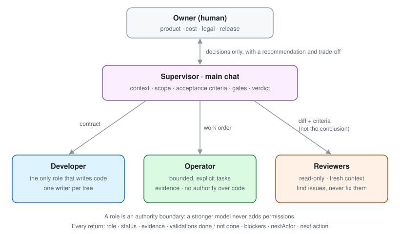
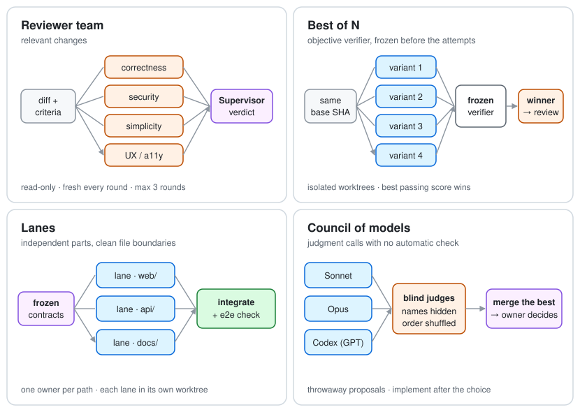
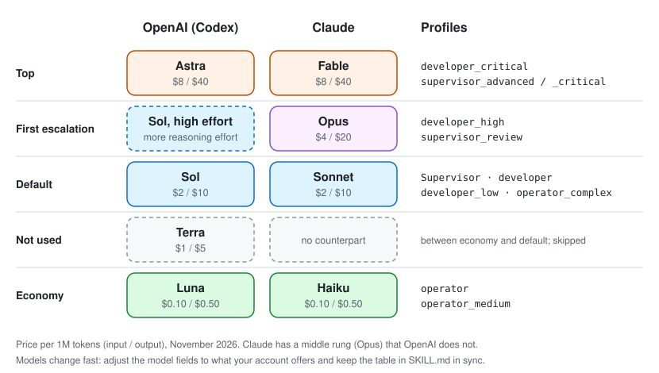

# Conductor Agent Roles

An agent skill that turns "use subagents" into a disciplined workflow with three roles and clear authority boundaries:

- **Supervisor**: the main chat. Builds context, defines scope, acceptance criteria and gates, delegates, and gives the independent verdict.
- **Developer**: the only role allowed to write code.
- **Operator**: executes bounded, explicit tasks and collects evidence. No authority over code.

Plus read-only **reviewers**, a model escalation ladder, and four multi-agent patterns:

- **Reviewer team**: parallel read-only reviewers, one focus each, fresh every round.
- **Best of N**: competing variants in isolated worktrees, picked by a verifier frozen before the attempts.
- **Lanes**: parallel Developers that each own a declared set of paths, with frozen contracts and an integration step.
- **Council of models**: independent proposals from different models, scored blind, for judgment calls without an automatic check.

It works with **Claude Code** and **OpenAI Codex** from the same skill folder, and ships a **claude.ai** variant for chats without subagents.



## Why

Multi-agent setups fail in predictable ways: two agents write to the same files, an agent approves its own work, a "reviewer" just confirms the hypothesis it was handed, a cheap model is trusted with a migration, a passing test gets reported as "released". This skill encodes the rules that prevent those failures:

- **A role is an authority boundary, not a model.** Escalating to a stronger model never grants more permissions.
- **One writer per tree.** Parallel writing only happens in isolated worktrees.
- **Independent review.** Reviewers get the diff and the criteria, never the Supervisor's conclusion or each other's findings.
- **Best of N only with a frozen, objective verifier.** No verifier, no tournament: use a council of models instead.
- **Parallelize only what is truly independent.** Lanes need a clean file boundary; coupled, step-by-step work and small fixes stay with a single Developer.
- **States are not interchangeable.** Implementation, local validation, CI, UI, staging and release are reported separately; one never proves another.
- **Humans decide human things.** Merge, deploy, publishing and production are never inferred from "go implement it".
- **The workflow is opt-in.** Ordinary tasks stay ordinary; the skill only activates when you ask for roles, delegation or parallel work.

## Which pattern when

Patterns are building blocks, not rules. Team setups win when the work splits cleanly and lose when each step depends on the last, so the skill only parallelizes what is truly independent and routes everything else to a single Developer.




## Model ladder

Profiles map to a cost/capability ladder. The two vendors' ladders do not have the same number of rungs: Claude has Opus between Sonnet and Fable, so Opus takes the "first escalation" slot that Sol at high effort fills on Codex.



| Profile | Claude Code | Codex |
|---|---|---|
| developer, operator_complex | sonnet / medium | gpt-6.2-sol / medium |
| developer_low | sonnet / low | gpt-6.2-sol / low |
| developer_high, supervisor_review | opus / high | gpt-6.2-sol / high |
| developer_critical, supervisor_critical | fable / high | gpt-6.2-astra / high |
| supervisor_advanced | fable / medium | gpt-6.2-astra / medium |
| operator | haiku / low | gpt-6-luna / low |
| operator_medium | haiku / medium | gpt-6-luna / medium |

Model names and the mapping reflect the lineups as of **November 2026**. Models change fast: adjust the `model` fields to whatever your account offers, and keep the skill's table in sync. If the top model is not available on your plan, the skill falls back to the rung below at high effort.

## Repository layout

```
skills/conductor-agent-roles/      # the skill (Claude Code + Codex)
  SKILL.md
  agents/openai.yaml               # Codex UI metadata
agents/claude-code/*.md            # Claude Code subagent profiles
agents/codex/*.toml                # Codex agent profiles
variants/claude-ai/                # claude.ai variant (no subagents)
docs/diagrams/*.svg                # diagrams (light and dark themes)
```

## Install

Clone the repository somewhere stable:

```bash
git clone https://github.com/carlospaulojr/conductor-agent-roles.git ~/conductor-agent-roles
```

### Claude Code

Link the skill and copy the subagent profiles:

```bash
mkdir -p ~/.claude/skills ~/.claude/agents
```

```bash
ln -s ~/conductor-agent-roles/skills/conductor-agent-roles ~/.claude/skills/conductor-agent-roles
```

```bash
cp ~/conductor-agent-roles/agents/claude-code/*.md ~/.claude/agents/
```

Start a new session so the profiles load. Then ask for the workflow explicitly, for example: "Act as Supervisor and delegate this fix to a Developer, then run a reviewer team."

### Codex

```bash
mkdir -p ~/.codex/skills ~/.codex/agents
```

```bash
ln -s ~/conductor-agent-roles/skills/conductor-agent-roles ~/.codex/skills/conductor-agent-roles
```

```bash
cp ~/conductor-agent-roles/agents/codex/*.toml ~/.codex/agents/
```

### Both on one machine

Point both symlinks at the same folder (as above). Claude Code and Codex then read one skill, and an edit applies to both.

### claude.ai

1. Zip the variant folder:

   ```bash
   cd ~/conductor-agent-roles/variants/claude-ai && zip -r conductor-agent-roles.zip conductor-agent-roles
   ```

2. In claude.ai, open **Settings → Capabilities**, make sure code execution is enabled, and use **Upload skill** in the Skills section.

The claude.ai variant runs the roles as sequential blocks in one conversation, and tells you which model and extended-thinking setting to pick when the work calls for escalation.

## Customizing

- **Your gates.** Project instructions (CLAUDE.md, AGENTS.md) can restrict permissions and add gates; the skill is written so they never silently widen them.
- **Language.** The skill text is in English; agents answer in whatever language you use.
- **Profiles.** Keep the profile names: the skill refers to them. Change models and effort freely, then update the table in `SKILL.md`.

## License

[MIT](LICENSE)
